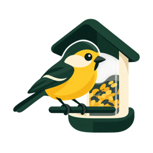

# Bird Buddy



Home Assistant-add-on met een Nederlandstalig dashboard voor recente foto's,
video's, batterij, laadstatus, wifi en firmware van je Bird Buddy (ook Pro,
voor zover de Bird Buddy-cloud deze gegevens levert).

## Installeren

1. Voeg `https://github.com/elgrande-nl/hassio-addons` toe bij de repositories
   van de Home Assistant add-onwinkel en vernieuw de lijst.
   Deze lokale wijziging moet daarvoor eerst in die repository gepubliceerd zijn.
   Alternatief: kopieer de map `birdbuddy` naar `/addons/birdbuddy` op je HA-host
   en vernieuw de winkel voor lokale add-ons.
2. Installeer **Bird Buddy** (amd64 of aarch64).
3. Vul bij Configuratie je Bird Buddy `email` en `password` in.
   Aanmelden met alleen Google/Apple/Facebook wordt niet ondersteund. Gebruik
   een account met e-mail/wachtwoord; eventueel een uitgenodigd tweede account.
4. Start en kies **Open webinterface**. De interface gebruikt Home Assistant
   Ingress en opent geen losse netwerkpoort.

De webinterface bundelt alle media van elk kaartje (waarneming) in één compacte
stapel. Gebruik de pijlen om foto’s en video’s te bekijken en het huidige bestand
te downloaden. Er staan maximaal vier waarnemingen op een pagina; onderaan
blader je naar de vorige of volgende pagina.

## Ophaalplanning

Open **Instellingen · ophaalplanning** in de webinterface en kies **Elk uur**
of **Eenmaal per dag**. Bij dagelijks kies je een lokaal tijdstip en tijdzone
(standaard `Europe/Amsterdam`). Opslaan werkt zonder herstart en de keuze blijft
bewaard in de lokale database. Een wijziging tijdens het ophalen geldt na die ronde.
De planning geldt alleen voor kaartjes, gevolgd door verzending. De accu- en
apparaatstatus worden onafhankelijk maximaal eenmaal per 24 uur opgevraagd.
De laatste status en het tijdstip blijven na een herstart bewaard. Ook na een
mislukte poging geldt de wachttijd van 24 uur. Handmatig kaartjes verversen
omzeilt deze limiet niet; een oude accustand kan dus bewust blijven staan.
**Nu verversen** blijft handmatig beschikbaar en verschuift de planning niet.

Elk uur is de standaard: een eerste controle bij de eerste start en daarna steeds
60 minuten na de vorige geplande poging. Een herstart voert geen extra ronde uit
als die nog niet aan de beurt is. Dagelijks wordt maximaal één geplande poging per
lokale dag gedaan; een gemist tijdstip wordt bij starten eenmaal ingehaald.
Ook een mislukte poging telt mee, zodat een storing geen herhaalde cloudcalls oplevert.
Bij zomertijd schuift een niet-bestaand tijdstip vooruit; een dubbel tijdstip in het
najaar wordt maar eenmaal uitgevoerd.

De begininstellingen staan ook bij `polling` in de add-onconfiguratie. Een in de
webinterface opgeslagen keuze heeft voorrang. `poll_seconds` is een verouderde
optie en wordt vanaf 0.2.0 niet meer gebruikt. De webinterface leest de lokale status
nog wel elke 15 seconden; dat veroorzaakt geen extra Bird Buddy-cloudverzoeken.

De add-on leest de laatste 7 dagen; `history_days` bepaalt de periode, `keep_cards`
het aantal lokaal bewaarde kaartjes (standaard 100). Media en de database staan in
`/share/birdbuddy`; neem die map mee in je back-ups. Een recente periode is geen
volledige import van je bestaande vogelcollecties.

Nieuwe, ongeopende kaartjes moeten via `identify_postcard` worden geïdentificeerd
om hun media te verkrijgen. Dit kan Bird Buddy's AI-identificatie starten en de
identificatiestatus in de app veranderen. De add-on verzamelt of verwijdert de
kaartjes niet. Al verzamelde kaartjes in de recente feed worden ook ingelezen.

## Telegram via je bestaande Home Assistant-bot

Er is geen extra Telegram-token nodig. De add-on roept `telegram_bot.send_photo`
of `telegram_bot.send_video` aan via de Supervisor API.

1. Geef je bestaande bot toestemming om in het kanaal te posten (meestal als
   beheerder) en autoriseer het kanaal bij de Telegram-integratie in HA.
2. Voeg aan je bestaande `homeassistant:`-configuratie toe:

   ```yaml
   homeassistant:
     allowlist_external_dirs:
       - /share/birdbuddy
   ```

   Voeg dit samen met een eventueel bestaande lijst en herstart Home Assistant.
3. Zet `telegram.enabled` op `true`, vul het numerieke kanaal-ID in bij `chat_id`
   (bijvoorbeeld `"-1001234567890"`). Bij meerdere bots vul je ook
   `config_entry_id` van de gewenste Telegram-integratie in.
4. Controleer eventueel eerst in HA bij Ontwikkelaarstools → Acties of
   `telegram_bot.send_photo` met een bestand uit deze map werkt.

`send_existing: false` voorkomt dat de eerste synchronisatie voor deze bestemming
oude kaartjes post. Zet dit vóór de eerste start op `true` om ook de ingelezen
kaartjes te versturen. Kaartjes die al lokaal aanwezig waren vóór het inschakelen
van een bestemming worden niet achteraf toegevoegd aan de verzendwachtrij.
Foto's en video's worden afzonderlijk verzonden met de vogelnaam als bijschrift.

Gebruik **Laatste waarneming testen** bovenaan de webinterface om de nieuwste
lokaal opgeslagen waarneming met alle media te sturen. Vogelnaam en datum staan
in het bijschrift. Meerdere foto's/video's worden als Telegram-album verstuurd
(maximaal tien per album); bij meer bestanden volgen meerdere albums, één bestand
gaat als losse foto/video. Dit vereist ook toegang tot `/share/birdbuddy` via
`allowlist_external_dirs`. Zonder opgeslagen media toont de knop een uitleg.
De test haalt geen nieuwe kaartjes op en verandert de automatische verzendwachtrij
niet: je kunt dezelfde waarneming bewust opnieuw testen. Bij een fout kan een deel
al zijn aangekomen; controleer Telegram voordat je opnieuw klikt.

## SFTP (optioneel, kan tegelijk met Telegram)

Vul `host`, `port`, `username`, `password` en `directory` in en zet `enabled`
op `true`. De doelmap moet al bestaan en schrijfbaar zijn. Dit is SFTP over SSH,
geen FTP of FTPS. Deze versie ondersteunt wachtwoordauthenticatie.

Plaats de gecontroleerde SSH-hostsleutel in bijvoorbeeld
`/share/birdbuddy_known_hosts` en zet `known_hosts` op dat pad. Voor een andere
poort dan 22 gebruik je de OpenSSH-notatie `[host]:poort` in het bestand.
Controleer de fingerprint via de beheerder van de server. Onbekende of gewijzigde
sleutels worden geweigerd. Bestanden krijgen een vaste hashnaam; uploads gaan
eerst naar `.part` en worden daarna hernoemd.

## Werking en beperkingen

- De interface toont de laatste succesvolle controle en fouten. Bij een fout
  blijven eerder opgehaalde kaartjes zichtbaar; de apparaatstatus kan verouderd zijn.
- Verzendingen worden per bestemming en mediabestand bijgehouden in SQLite.
  Tijdelijke fouten worden bij een volgende controle opnieuw geprobeerd.
  Bij een crash vlak na verzenden maar vóór opslaan van de bevestiging kan
  een Telegram-bericht dubbel aankomen.
- Een afgehandelde verzending kan ook bewust overgeslagen zijn tijdens de
  eerste synchronisatie (`send_existing: false`).
- Kaartjes met openstaande verzendingen worden niet automatisch verwijderd.
  Langdurige verzendproblemen kunnen dus meer schijfruimte gebruiken dan
  `keep_cards` suggereert. Schakel een bestemming pas in als hij bereikbaar is.
- Maximaal 100 MiB per mediabestand. Telegram kan aanvullende bestandslimieten
  hanteren. De dashboardknop vraagt een nieuwe controle aan; lopende controles
  worden niet onderbroken.
- Geheime opties staan in de Home Assistant-add-onconfiguratie. De webinterface
  levert deze niet uit. Media in `/share` zijn toegankelijk voor andere add-ons
  met toegang tot die map.
- De onofficiële Bird Buddy-cloud-API kan wijzigen; er is geen directe lokale
  verbinding met de feeder. Niet beschikbare statusvelden tonen “onbekend”.

Bronnen: [pybirdbuddy](https://github.com/jhansche/pybirdbuddy),
[Telegram-integratie](https://www.home-assistant.io/integrations/telegram_bot/).

## Lokale controles

```sh
python3 -m venv /tmp/birdbuddy-venv
/tmp/birdbuddy-venv/bin/pip install -r birdbuddy/requirements.txt
/tmp/birdbuddy-venv/bin/python -m unittest discover -s birdbuddy/tests -v
```

Een echte installatie vereist aanvullend testen met je Bird Buddy-account,
Home Assistant Supervisor en eventueel je Telegram-kanaal/SFTP-server.

## Beveiliging en AppArmor

De add-on bevat een eigen `apparmor.txt` in afdwingende modus, naast Ingress
zonder gepubliceerde poorten. Het profiel laat Python en zijn bibliotheken
lezen/uitvoeren, staat netwerkverkeer toe voor Ingress, DNS, Bird Buddy,
Home Assistant en SFTP, en beperkt schrijven tot `/share/birdbuddy` en `/tmp`.
Bestanden elders in `/share` zijn alleen leesbaar voor het instelbare
`known_hosts`-bestand. Er is geen uitvoering van shells of losse SSH-programma’s
nodig; SFTP draait binnen Python.

De verwachte score is **8** zodra Supervisor het profiel succesvol heeft geladen:
basisscore 5, Ingress +2 en een geladen eigen AppArmor-profiel +1. De winkel kan
vóór installatie nog 7 tonen. De score zegt niets over de werking van de
Bird Buddy-API en is geen volledige beveiligingsaudit.

Controle na installeren/updaten op Home Assistant OS:

1. Laat de beschermingsmodus ingeschakeld en controleer of de add-on start.
2. Test status ophalen, kaartjes downloaden, lokaal bewaren, afspelen en
   downloaden, Telegram testen en (indien ingesteld) SFTP.
3. Controleer de Supervisor-/hostlogboeken op fouten bij het laden van het
   profiel en `apparmor="DENIED"`. Meld bij een blokkade de geweigerde
   bestandslocatie/operatie zodat het profiel gericht kan worden aangepast.

Het AppArmor-profiel kan op deze macOS-ontwikkelomgeving niet door de Linux-kernel
worden geladen of getest. Controle van dit profiel op de HA-host blijft nodig.
Zie [Home Assistant: beveiliging](https://contributors.home-assistant.io/apps/guides/security/)
en [berekening veiligheidsscore](https://contributors.home-assistant.io/apps/reference/security-rating/).

Telegram-tests zijn begrensd tot 20 MiB totaal (foto’s maximaal 10 MiB per stuk).
Te grote tests worden vóór verzending geweigerd. Automatisch worden maximaal vier
mediabestanden per controleronde geprobeerd; de rest blijft in de wachtrij.
Deze limieten beperken belasting, maar garanderen geen vrij geheugen op de HA-host.

De client leest kaartjes via de Bird Buddy-cloudfeed. Deze route vraagt niet
expliciet om een apparaatstatusverversing of livestream. Aanmelden of een
cloudrespons kan wel door Bird Buddy meegeleverde feedergegevens bevatten;
we kunnen niet garanderen hoe hun backend intern met het apparaat communiceert.
